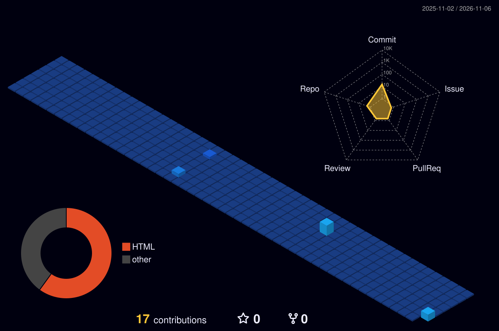

  

<h3 align="center">Software Engineering @ Sichuan University · Class of 2027</h3>

  

---

<h2 align="center"> WHO I AM</h2>

Software Engineering undergraduate at **Sichuan University**, Chengdu. I build practical systems that connect **software, data, and hardware**.

Since **November 2025** I work as a freelance automation developer, designing end-to-end workflows and integrations. I'm now moving deeper into AI and intelligent systems.

 

<h2 align="center"> WHAT I DO</h2>

| | |
|---|---|
| **Workflow Automation** | End-to-end n8n pipelines, API integrations, event-driven processes |
| **AI & Intelligent Systems** | LLM-powered tools, voice assistants, agent-style workflows |
| **Embedded Systems** | ESP32 devices with sensing, display, and voice interaction |
| **Big Data** | Processing and analysis of large real-world datasets |

<h2 align="center"> VISION</h2>

Build intelligent systems that solve real problems, and deepen that work through a Master's degree in Computer Science.

---

<h2 align="center"> FEATURED PROJECTS</h2>

<table>
  <tr>
    <td width="33%" valign="top">
      <h3> <a href="REPO_LINK">Airi</a></h3>
      ESP32 desk robot for air-quality monitoring and companionship. <i>Thesis project.</i>  
      <b>Stack:</b> ESP32-S3 · C++ · sensors · voice
    </td>
    <td width="33%" valign="top">
      <h3> <a href="REPO_LINK">Yelp Big Data</a></h3>
      Large-scale analysis of the Yelp dataset. <i>Team project.</i>  
      <b>My part:</b> DESCRIBE YOUR CONTRIBUTION 
      <b>Stack:</b> LIST TOOLS
    </td>
    <td width="33%" valign="top">
      <h3> <a href="REPO_LINK">Auto-Posting</a></h3>
      Automated content-posting pipeline.  
      <b>Flow:</b> DESCRIBE FLOW 
      <b>Stack:</b> n8n · LIST APIs
    </td>
  </tr>
</table>

---

<h2 align="center">🌐 CONNECT</h2>

<table>
  <tr>
    <th>LinkedIn</th><th>Email (Uni)</th><th>Gmail</th><th>Website</th>
  </tr>
  <tr>
    <td align="center">   </td>
    <td align="center">   </td>
    <td align="center">   </td>
    <td align="center">   </td>
  </tr>
</table>

---

<h2 align="center">🧊 CONTRIBUTIONS</h2>

  

<h2 align="center">🧰 SKILL SET</h2>

<table>
  <tr>
    <td align="center" width="12%"> Python</td>
    <td align="center" width="12%"> JS</td>
    <td align="center" width="12%"> C++</td>
    <td align="center" width="12%"> Arduino</td>
    <td align="center" width="12%"> n8n</td>
    <td align="center" width="12%"> Git</td>
    <td align="center" width="12%"> GitHub</td>
    <td align="center" width="12%"> VS Code</td>
     </tr>
      <tr>
    <td align="center"> ESP32</td>
    <td align="center"> Arduino</td>
    <td align="center"> Embedded C</td>
    <td align="center"> Raspberry Pi</td>
    <td align="center"> OpenCV</td>
    <td align="center"> ROS</td>
    <td align="center"> MQTT</td>
    <td align="center"> PlatformIO</td>
  </tr>
  <tr>
    <td align="center"> Pandas</td>
    <td align="center"> NumPy</td>
    <td align="center"> Jupyter</td>
    <td align="center"> MySQL</td>
    <td align="center"> Docker</td>
    <td align="center"> Linux</td>
    <td align="center"> HTML</td>
    <td align="center"> CSS</td>
  </tr>
</table>

  

